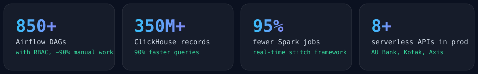
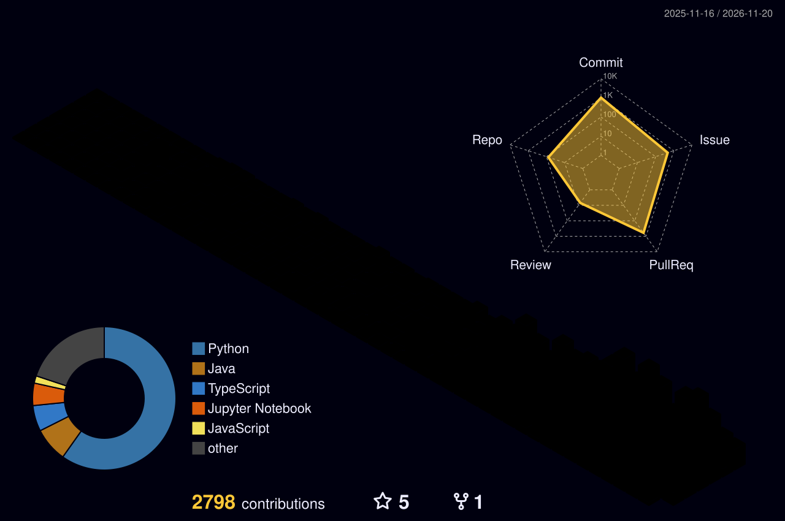

  <a href="https://www.sepurisaikrishna.com">Portfolio</a> &nbsp;·&nbsp;
  <a href="https://www.sepurisaikrishna.com/agent">Chat with my AI</a> &nbsp;·&nbsp;
  <a href="https://www.linkedin.com/in/sepuri-saikrishna-b9555b278/">LinkedIn</a> &nbsp;·&nbsp;
  <a href="mailto:sepurisaikrishna55@gmail.com">Email</a> &nbsp;·&nbsp;
  <a href="https://leetcode.com/u/sai_krishna123/">LeetCode</a>

## Impact at a glance

  

## Currently building

**[Systems from Zero](https://systems-from-zero.pages.dev)**: a personal project tracing how real systems grow from their first useful version, one guide per part, from a single card payment to what happens when you open a website.

## Experience

**Senior Data Engineer** @ [Perfios](https://perfios.ai/) · *Apr 2025 – Present*
Design & deploy AI agents over MCP for secure context-sharing across LLM tools (shown at GFF 2025) · run an Apache Airflow ecosystem of 850+ DAGs with RBAC & custom operators (−90% manual maintenance) · built 20+ reusable Spark/Flink connectors via no-code config.

**Data Engineer** @ [Perfios](https://perfios.ai/) · *Aug 2023 – Mar 2025*
Architected a declarative, real-time data-stitching framework (Python, Kafka, Cassandra, Elasticsearch) → 95% fewer redundant Spark jobs, 99% better data-freshness SLA · shipped 8+ serverless REST APIs on AWS Lambda live at **AU Bank, Kotak Bank & Axis Bank** · built a YAML-driven DAG factory cutting manual DAG coding by 90%.

**Software Engineer Intern** @ Karza Technologies (a Perfios company) · *Jan 2023 – Jul 2023*
Optimized Elasticsearch fuzzy-matching logic: 92% lower query latency, 80% better name-match accuracy.

🎓 B.Tech, Computer Science & Engineering (Data Analytics), Vellore Institute of Technology, 2019–2023

## Personal Projects

Independent builds & research, outside of work.

| Project | What it is |
|---|---|
| **[Blueprint](https://blueprint-o3q.pages.dev)** | Teaches the reasoning behind DSA problems, not just the solutions |
| **[Mastery: Python & Java](https://twolang-lab.pages.dev)** | Every language feature actually executed, with real recorded output |
| **[Toolforge](https://toolforge-3et.pages.dev)** | 38 deep guides tracing databases, streaming systems & orchestrators to their failure modes |
| **[TraceQuest](https://tracequest-d0m.pages.dev)** | Step-by-step traces of how real systems work under the hood |
| **[The Migration Line](https://migrations.sepurisaikrishna.com)** | Engineering migrations, monitored like live production systems |
| **[Fieldnotes](https://fieldnotes-15h.pages.dev)** | A personal study library for learning one CS idea well, slowly |

More at → [sepurisaikrishna.com/projects](https://www.sepurisaikrishna.com/projects)

## Arsenal

**Big Data & Streaming:** `Python` `Java` `SQL` `Spark` `Flink` `Kafka` `ksqlDB` `Airflow`

**Data Platforms & Stores:** `Trino` `ClickHouse` `Iceberg` `SeaTunnel` `Superset` `Dagster` `Cassandra` `MongoDB` `Elasticsearch` `JanusGraph`

**AI & Agents:** `MCP` `LangChain` `AutoGen` `OpenAI API` `LLMs`

**Cloud & DevOps:** `AWS` `Docker` `GitLab CI/CD` `MinIO`

## GitHub in numbers

 

## 3D Contribution Skyline

  

## Full Metrics

  

  <picture>
    <source media="(prefers-color-scheme: dark)" srcset="https://raw.githubusercontent.com/SEPURI-SAI-KRISHNA/SEPURI-SAI-KRISHNA/output/github-snake-dark.svg" />
    
  </picture>

Built from <a href="https://www.sepurisaikrishna.com">sepurisaikrishna.com</a> · updated as I ship.

